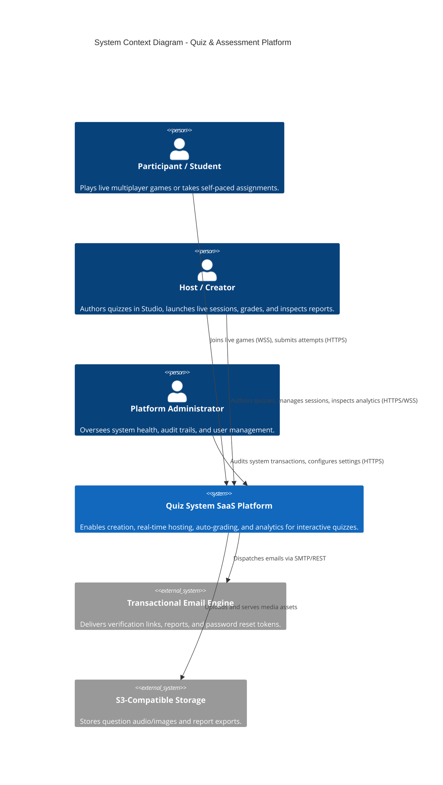
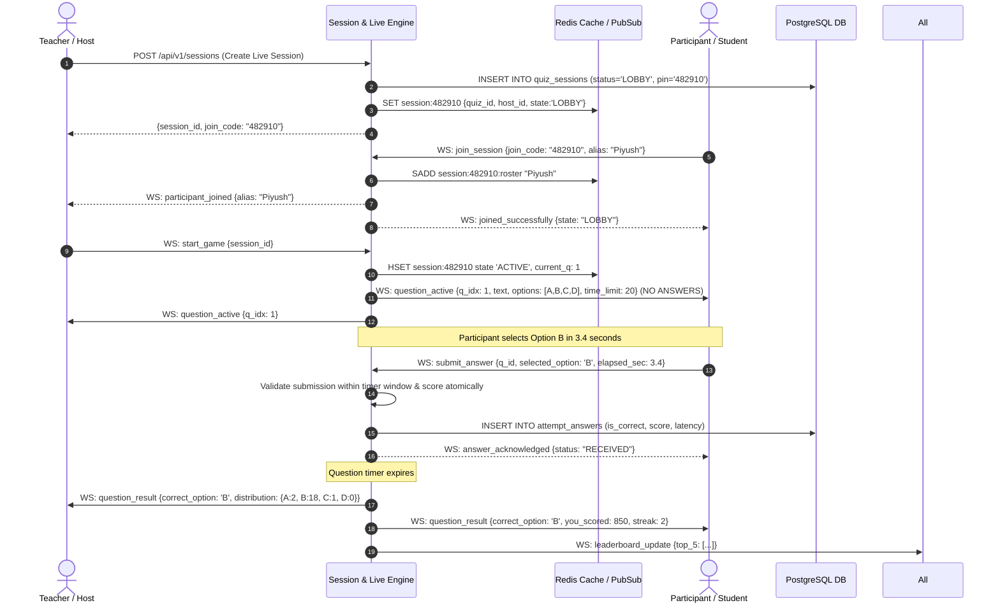
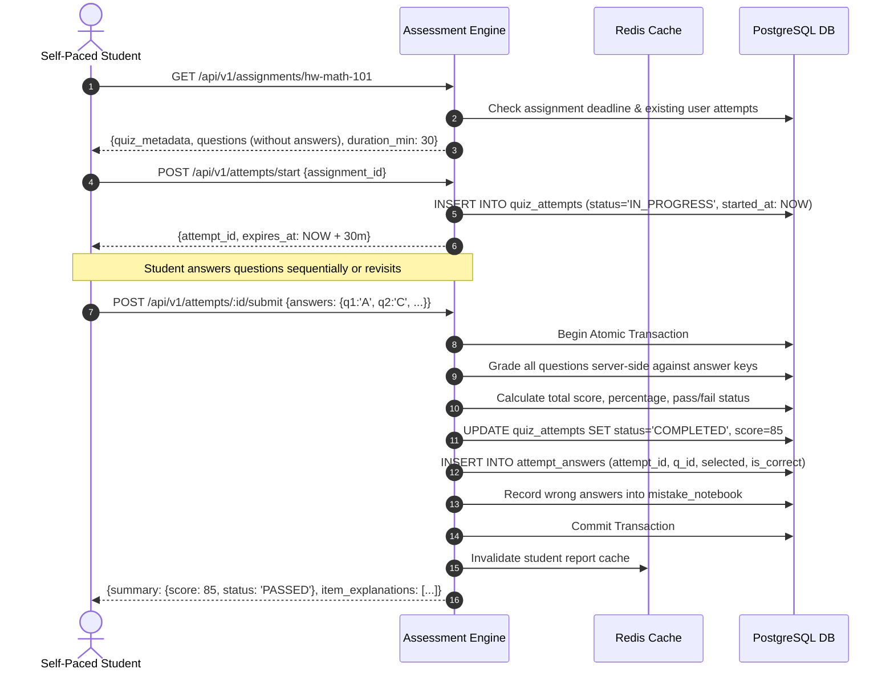

# System Architecture & Component Design
## Modular Monolith Topology, Event Pipelines, and Domain Boundaries

---

### 1. System Context Diagram (C4 Level 1)



---

### 2. High-Level Component Architecture (C4 Level 2)

```mermaid
flowchart TB
    subgraph ClientTier ["Client Layer"]
        HostUI["Host / Creator Studio (React)"]
        PlayerUI["Participant Live Arena & Self-Paced UI (React)"]
        AdminUI["Admin & Analytics Cockpit (React)"]
    end

    subgraph GatewayTier ["Gateway & Security Boundary"]
        ReverseProxy["Nginx / Caddy Reverse Proxy"]
        RateLimiter["Rate Limiting & DDoS Shield (Redis Token Bucket)"]
        AuthMiddleware["JWT Authentication & RBAC Guard"]
    end

    subgraph AppTier ["Modular Monolith Application Core"]
        AuthModule["1. Auth & Identity Module"]
        QuizModule["2. Quiz & Question Studio"]
        SessionModule["3. Session Lifecycle Manager"]
        LiveEngine["4. Real-Time Game Orchestrator (Socket.io)"]
        ScoringEngine["5. Atomic Auto-Grading & Scoring Engine"]
        AssignmentModule["6. Assignment & Deadline Scheduler"]
        MistakeModule["7. Mistake Notebook & Smart Revision"]
        AnalyticsModule["8. Analytics & Report Generator"]
        AuditModule["9. Audit Logging & Poka-Yoke Telemetry"]
    end

    subgraph DataTier ["Persistence & Distributed State"]
        PG[(PostgreSQL 16 Primary Relational DB)]
        RedisCache[(Redis In-Memory Session Cache & Pub/Sub)]
    end

    ClientTier -->|HTTPS / WSS| ReverseProxy
    ReverseProxy --> RateLimiter
    RateLimiter --> AuthMiddleware
    AuthMiddleware --> AppTier

    SessionModule <--> LiveEngine
    LiveEngine --> ScoringEngine
    ScoringEngine --> MistakeModule
    AppTier --> PG
    AppTier --> RedisCache
    LiveEngine <..> RedisCache
```

---

### 3. Backend Domain Boundaries & Responsibility Matrix

| Module | Core Responsibilities | Dependencies | Data Access Pattern |
| :--- | :--- | :--- | :--- |
| **Auth & Identity** | Registration, login, password hashing (Argon2id), JWT issuance, refresh token rotation, role evaluation. | None | Synchronous ACID writes to `users`, `user_tokens`. |
| **Quiz Studio** | Authoring quizzes, question formulation, distractor management, validation, version incrementing. | Auth | Read/Write to `quizzes`, `questions`, `question_options`. |
| **Session Manager** | Creation of live session PINs, lifecycle state machines (`LOBBY` $\rightarrow$ `ACTIVE` $\rightarrow$ `FINISHED`), assignment scheduling. | Quiz Studio | Read/Write to `quiz_sessions`, Redis TTL storage. |
| **Live Game Engine** | WebSocket room management, pin-based joining, client connection heartbeats, synchronized question distribution. | Session Manager | Redis Pub/Sub, in-memory roster lookup. |
| **Scoring Engine** | Zero-latency answer evaluation, speed multiplier computation, streak adjustments, atomic attempt persistence. | Quiz, Session | High-frequency atomic inserts into `attempts`, `attempt_answers`. |
| **Mistake Notebook** | Automated recording of learner failure modes, spaced-repetition filtering, smart practice quiz synthesis. | Scoring Engine | Asynchronous event-driven write to `mistake_notebook`. |
| **Analytics Engine** | Item difficulty indexing, cohort pass rates, student gradebooks, audit transaction streaming. | Scoring, Session | Read-heavy queries with Redis caching layer. |

---

### 4. Live Multiplayer Quiz Lifecycle Pipeline



---

### 5. Self-Paced Quiz Lifecycle Pipeline


