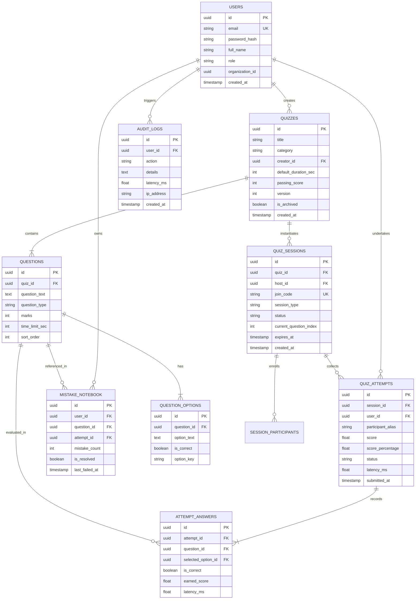

# Database Architecture & Relational Schema
## PostgreSQL Normalized Data Model, Indexing Strategy, and Integrity Guards

---

### 1. Entity-Relationship Diagram (ERD)

---

### 2. Comprehensive Relational Data Dictionaries

#### 2.1 Table: `users`
- **Purpose:** Stores authenticated user identities, credentials, role configurations, and institutional tenant markers.
- **Columns:**
  - `id`: `UUID PRIMARY KEY DEFAULT gen_random_uuid()`
  - `email`: `VARCHAR(255) UNIQUE NOT NULL`
  - `password_hash`: `VARCHAR(255) NOT NULL` (Argon2id format)
  - `full_name`: `VARCHAR(150) NOT NULL`
  - `role`: `VARCHAR(50) NOT NULL CHECK (role IN ('SUPERADMIN', 'TEACHER', 'STUDENT'))`
  - `organization_id`: `UUID NULL` (Tenant isolation anchor for future institutional scaling)
  - `created_at`: `TIMESTAMPTZ NOT NULL DEFAULT NOW()`
  - `updated_at`: `TIMESTAMPTZ NOT NULL DEFAULT NOW()`
- **Indexes:**
  - `CREATE UNIQUE INDEX idx_users_email ON users(LOWER(email));`
  - `CREATE INDEX idx_users_org ON users(organization_id);`

#### 2.2 Table: `quizzes`
- **Purpose:** Canonical definition of reusable quizzes, categories, default pass thresholds, and author references.
- **Columns:**
  - `id`: `UUID PRIMARY KEY DEFAULT gen_random_uuid()`
  - `creator_id`: `UUID NOT NULL REFERENCES users(id) ON DELETE CASCADE`
  - `title`: `VARCHAR(255) NOT NULL`
  - `description`: `TEXT`
  - `category`: `VARCHAR(100) NOT NULL`
  - `passing_score`: `INT NOT NULL DEFAULT 60 CHECK (passing_score >= 1 AND passing_score <= 100)`
  - `default_duration_sec`: `INT NOT NULL DEFAULT 600 CHECK (default_duration_sec > 0)`
  - `version`: `INT NOT NULL DEFAULT 1`
  - `is_archived`: `BOOLEAN NOT NULL DEFAULT FALSE`
  - `created_at`: `TIMESTAMPTZ NOT NULL DEFAULT NOW()`
- **Indexes:**
  - `CREATE INDEX idx_quizzes_creator ON quizzes(creator_id);`
  - `CREATE INDEX idx_quizzes_category_active ON quizzes(category, is_archived);`
  - `CREATE INDEX idx_quizzes_title_trgm ON quizzes USING gin(title gin_trgm_ops);` (Fast fuzzy catalog search $< 40\text{ ms}$)

#### 2.3 Table: `questions`
- **Purpose:** Individual questions belonging to a quiz.
- **Columns:**
  - `id`: `UUID PRIMARY KEY DEFAULT gen_random_uuid()`
  - `quiz_id`: `UUID NOT NULL REFERENCES quizzes(id) ON DELETE CASCADE`
  - `question_text`: `TEXT NOT NULL`
  - `question_type`: `VARCHAR(50) NOT NULL CHECK (question_type IN ('MCQ_SINGLE', 'MCQ_MULTI', 'TRUE_FALSE', 'SHORT_ANSWER'))`
  - `marks`: `INT NOT NULL DEFAULT 1 CHECK (marks > 0)`
  - `time_limit_sec`: `INT NOT NULL DEFAULT 20 CHECK (time_limit_sec >= 5 AND time_limit_sec <= 300)`
  - `sort_order`: `INT NOT NULL DEFAULT 1`
  - `explanation`: `TEXT` (Shown only after attempt completion)
- **Indexes:**
  - `CREATE INDEX idx_questions_quiz_sort ON questions(quiz_id, sort_order ASC);`

#### 2.4 Table: `question_options`
- **Purpose:** Candidate answers/distractors for questions.
- **Columns:**
  - `id`: `UUID PRIMARY KEY DEFAULT gen_random_uuid()`
  - `question_id`: `UUID NOT NULL REFERENCES questions(id) ON DELETE CASCADE`
  - `option_key`: `VARCHAR(10) NOT NULL` (e.g., 'A', 'B', 'C', 'D')
  - `option_text`: `TEXT NOT NULL`
  - `is_correct`: `BOOLEAN NOT NULL DEFAULT FALSE`
- **Indexes:**
  - `CREATE INDEX idx_options_question ON question_options(question_id);`
  - `CREATE UNIQUE INDEX idx_unique_option_key_per_question ON question_options(question_id, option_key);`

#### 2.4.1 Table: `question_answers`
- **Purpose:** Accepted text/numerical answers for `FILL_BLANK`, `SHORT_ANSWER`, and `NUMERICAL` questions.
- **Columns:**
  - `id`: `UUID PRIMARY KEY DEFAULT gen_random_uuid()`
  - `question_id`: `UUID NOT NULL REFERENCES questions(id) ON DELETE CASCADE`
  - `expected_answer`: `TEXT NOT NULL`
  - `is_case_sensitive`: `BOOLEAN NOT NULL DEFAULT FALSE`
  - `numeric_tolerance`: `FLOAT NOT NULL DEFAULT 0.0`

#### 2.4.2 Table: `quiz_versions`
- **Purpose:** Immutable JSON snapshots captured upon quiz publication for historical attempt preservation.
- **Columns:**
  - `id`: `UUID PRIMARY KEY DEFAULT gen_random_uuid()`
  - `quiz_id`: `UUID NOT NULL REFERENCES quizzes(id) ON DELETE CASCADE`
  - `version`: `INT NOT NULL`
  - `title`: `VARCHAR(255) NOT NULL`
  - `snapshot_data`: `TEXT NOT NULL`
  - `published_at`: `TIMESTAMPTZ NOT NULL DEFAULT NOW()`
  - `published_by`: `UUID NOT NULL REFERENCES users(id)`

#### 2.4.3 Table: `question_bank`
- **Purpose:** Reusable repository of curated questions owned by instructors.
- **Columns:**
  - `id`: `UUID PRIMARY KEY DEFAULT gen_random_uuid()`
  - `creator_id`: `UUID NOT NULL REFERENCES users(id) ON DELETE CASCADE`
  - `title`: `VARCHAR(255) NOT NULL`
  - `question_text`: `TEXT NOT NULL`
  - `question_type`: `VARCHAR(50) NOT NULL`
  - `category`: `VARCHAR(100) NOT NULL DEFAULT 'General'`
  - `difficulty`: `VARCHAR(50) NOT NULL DEFAULT 'MEDIUM'`
  - `marks`: `FLOAT NOT NULL DEFAULT 1.0`
  - `options_data`: `TEXT DEFAULT '[]'`
  - `settings`: `TEXT DEFAULT '{}'`

#### 2.5 Table: `quiz_sessions`
- **Purpose:** Live multiplayer rooms or active assignment schedules.
- **Columns:**
  - `id`: `UUID PRIMARY KEY DEFAULT gen_random_uuid()`
  - `quiz_id`: `UUID NOT NULL REFERENCES quizzes(id) ON DELETE RESTRICT`
  - `host_id`: `UUID NOT NULL REFERENCES users(id) ON DELETE CASCADE`
  - `join_code`: `VARCHAR(10) UNIQUE NULL` (e.g. '829401' for live pin-join)
  - `session_type`: `VARCHAR(50) NOT NULL CHECK (session_type IN ('LIVE_SYNC', 'SELF_PACED_ASSIGNMENT'))`
  - `status`: `VARCHAR(50) NOT NULL CHECK (status IN ('LOBBY', 'ACTIVE', 'PAUSED', 'COMPLETED'))`
  - `current_question_index`: `INT NOT NULL DEFAULT 0`
  - `expires_at`: `TIMESTAMPTZ NULL`
  - `created_at`: `TIMESTAMPTZ NOT NULL DEFAULT NOW()`
- **Indexes:**
  - `CREATE UNIQUE INDEX idx_sessions_active_pin ON quiz_sessions(join_code) WHERE status != 'COMPLETED';`
  - `CREATE INDEX idx_sessions_host ON quiz_sessions(host_id, status);`

#### 2.6 Table: `quiz_attempts` (Phase P3 Implemented)
- **Purpose:** Student interaction record with a quiz (self-paced attempt).
- **Columns:**
  - `id`: `TEXT PRIMARY KEY` (UUIDv4)
  - `quiz_id`: `TEXT NOT NULL REFERENCES quizzes(id) ON DELETE CASCADE`
  - `quiz_version`: `INTEGER NOT NULL DEFAULT 1`
  - `user_id`: `TEXT NOT NULL REFERENCES users(id) ON DELETE CASCADE`
  - `status`: `TEXT NOT NULL DEFAULT 'IN_PROGRESS' CHECK (status IN ('IN_PROGRESS', 'COMPLETED', 'EXPIRED', 'ABANDONED'))`
  - `score`: `REAL NOT NULL DEFAULT 0.0`
  - `max_score`: `REAL NOT NULL DEFAULT 0.0`
  - `score_percentage`: `REAL NOT NULL DEFAULT 0.0`
  - `is_passed`: `INTEGER NOT NULL DEFAULT 0`
  - `total_questions`: `INTEGER NOT NULL DEFAULT 0`
  - `correct_answers`: `INTEGER NOT NULL DEFAULT 0`
  - `incorrect_answers`: `INTEGER NOT NULL DEFAULT 0`
  - `unanswered_count`: `INTEGER NOT NULL DEFAULT 0`
  - `time_limit_sec`: `INTEGER NOT NULL DEFAULT 0`
  - `started_at`: `DATETIME NOT NULL DEFAULT CURRENT_TIMESTAMP`
  - `expires_at`: `DATETIME NULL`
  - `submitted_at`: `DATETIME NULL`
  - `time_taken_sec`: `INTEGER NOT NULL DEFAULT 0`
  - `idempotency_key`: `TEXT NULL UNIQUE`
- **Indexes:**
  - `CREATE INDEX idx_attempts_user ON quiz_attempts(user_id, status);`
  - `CREATE INDEX idx_attempts_quiz ON quiz_attempts(quiz_id, submitted_at DESC);`

#### 2.7 Table: `attempt_answers` (Phase P3 Implemented)
- **Purpose:** Item-by-item granular answers, evaluation status, and awarded points.
- **Columns:**
  - `id`: `TEXT PRIMARY KEY` (UUIDv4)
  - `attempt_id`: `TEXT NOT NULL REFERENCES quiz_attempts(id) ON DELETE CASCADE`
  - `question_id`: `TEXT NOT NULL`
  - `question_type`: `TEXT NOT NULL`
  - `user_answer`: `TEXT NOT NULL DEFAULT ''` (JSON-serialized or raw string)
  - `is_correct`: `INTEGER NOT NULL DEFAULT 0`
  - `earned_score`: `REAL NOT NULL DEFAULT 0.0`
  - `max_marks`: `REAL NOT NULL DEFAULT 1.0`
  - `is_evaluated`: `INTEGER NOT NULL DEFAULT 1`
  - `evaluation_notes`: `TEXT DEFAULT ''`
  - `saved_at`: `DATETIME NOT NULL DEFAULT CURRENT_TIMESTAMP`
  - `UNIQUE(attempt_id, question_id)`
- **Indexes:**
  - `CREATE INDEX idx_attempt_answers_attempt ON attempt_answers(attempt_id);`

#### 2.8 Table: `mistake_notebook` (Phase P3 Implemented)
- **Purpose:** Automatic pedagogical feedback repository storing learner failure modes for revision.
- **Columns:**
  - `id`: `TEXT PRIMARY KEY` (UUIDv4)
  - `user_id`: `TEXT NOT NULL REFERENCES users(id) ON DELETE CASCADE`
  - `attempt_id`: `TEXT NOT NULL REFERENCES quiz_attempts(id) ON DELETE CASCADE`
  - `quiz_id`: `TEXT NOT NULL REFERENCES quizzes(id) ON DELETE CASCADE`
  - `question_id`: `TEXT NOT NULL`
  - `quiz_title`: `TEXT NOT NULL`
  - `question_text`: `TEXT NOT NULL`
  - `question_type`: `TEXT NOT NULL`
  - `subject`: `TEXT NOT NULL DEFAULT 'General'`
  - `user_answer`: `TEXT NOT NULL DEFAULT ''`
  - `correct_answer`: `TEXT NOT NULL DEFAULT ''`
  - `explanation`: `TEXT NOT NULL DEFAULT ''`
  - `is_resolved`: `INTEGER NOT NULL DEFAULT 0`
  - `mistake_count`: `INTEGER NOT NULL DEFAULT 1`
  - `created_at`: `DATETIME NOT NULL DEFAULT CURRENT_TIMESTAMP`
  - `reviewed_at`: `DATETIME NULL`
  - `UNIQUE(user_id, question_id)`
- **Indexes:**
  - `CREATE INDEX idx_mistakes_user ON mistake_notebook(user_id, is_resolved);`
  - `CREATE INDEX idx_mistakes_subject ON mistake_notebook(user_id, subject);`

#### 2.9 Table: `audit_logs`
- **Purpose:** Immutable append-only audit trail for TQM traceability and security monitoring.
- **Columns:**
  - `id`: `UUID PRIMARY KEY DEFAULT gen_random_uuid()`
  - `user_id`: `UUID NULL REFERENCES users(id) ON DELETE SET NULL`
  - `action`: `VARCHAR(100) NOT NULL` (e.g., 'CREATE_QUIZ', 'UPDATE_PASSING_SCORE')
  - `details`: `TEXT NOT NULL`
  - `latency_ms`: `FLOAT NOT NULL DEFAULT 0.0`
  - `ip_address`: `VARCHAR(45)`
  - `created_at`: `TIMESTAMPTZ NOT NULL DEFAULT NOW()`
- **Indexes:**
  - `CREATE INDEX idx_audit_created ON audit_logs(created_at DESC);`

---

### 3. Critical Integrity & Security Rules

1. **Answer Masking at Persistence Level:**
   - Client queries fetching quiz sessions for active players use SQL projections that explicitly omit `question_options.is_correct` and `questions.explanation`.
2. **Preventing Broken Attempt History on Quiz Edits:**
   - Quizzes use a numeric `version` column. When a published quiz is edited, either a new version snapshot is saved or existing session records reference the immutable question snapshot in Redis/Postgres.
   - Deleting a Quiz triggers an **archive soft-delete** (`is_archived = TRUE`) rather than a hard cascade delete, preserving historical scores for alumni/past students.
3. **Idempotent Atomic Submissions:**
   - `attempt_answers` enforces `UNIQUE(attempt_id, question_id)`. Any duplicate submission packet is discarded at the database constraint layer, preventing race-condition score inflation.
