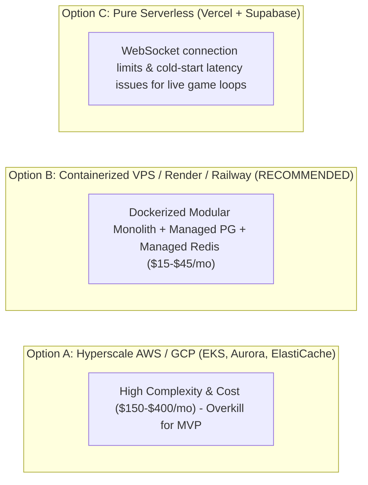

# Deployment, Infrastructure & DevOps Blueprint
## Containerization, Environment Matrix, CI/CD Pipeline, and Disaster Recovery

---

### 1. Realistic MVP Hosting Topology

To minimize cloud bills while providing enterprise-grade availability and low latency, we evaluate three realistic deployment models:



**Recommendation: Option B (Containerized Docker Architecture on Railway / Render / DigitalOcean VPS).**
- Single Dockerized Node.js runtime hosting HTTP and WebSocket endpoints.
- Managed PostgreSQL 16 instance with automated daily snapshots.
- Managed Redis 7 instance for in-memory session caching and Pub/Sub backplane.
- Total operational cost: **\$15 – \$35 per month** for the entire production stack.

---

### 2. Environment Configuration Matrix

All sensitive values are injected strictly via system environment variables. Zero hardcoded secrets in source files.

| Environment Variable | Description | Required In | Sensitivity |
| :--- | :--- | :--- | :--- |
| `NODE_ENV` | Runtime mode (`development`, `staging`, `production`) | All | Low |
| `PORT` | HTTP/WS port (e.g. `5000`) | All | Low |
| `DATABASE_URL` | PostgreSQL connection string with SSL mode | Staging/Prod | **Critical Secret** |
| `REDIS_URL` | Redis connection URI with authentication credentials | Staging/Prod | **Critical Secret** |
| `JWT_ACCESS_SECRET` | 256-bit entropy key for signing access tokens | All | **Critical Secret** |
| `JWT_REFRESH_SECRET`| 256-bit entropy key for signing refresh cookies | All | **Critical Secret** |
| `CORS_ORIGIN` | Allowed client origin URL (e.g. `https://quiz.example.com`)| Staging/Prod | Moderate |

---

### 3. Continuous Integration & Continuous Deployment (CI/CD Pipeline)

```mermaid
flowchart TD
    Push[Git Push to 'main' or Pull Request] --> Lint[Step 1: ESLint & TypeScript Typecheck]
    Lint --> Unit[Step 2: Run Unit Test Suite (Vitest)]
    Unit --> Integration[Step 3: Run DB Integration Tests (PostgreSQL Test Container)]
    Integration --> Build[Step 4: Vite Production Frontend Build & Docker Image Build]
    Build --> Deploy{Branch is 'main'?}
    Deploy -- Yes --> Staging[Step 5: Zero-Downtime Deploy to Staging/Production]
    Deploy -- No --> Review[Pass PR Status Checks]
```

1. **Automated Database Migrations:**
   - Executed via Prisma / Drizzle CLI (`npx prisma migrate deploy`) during the container startup sequence before accepting incoming traffic.
   - Backward-compatible schema evolution (e.g., adding nullable columns first, dropping obsolete columns only in subsequent releases).
2. **Health Checks & Monitoring:**
   - Endpoint `/health/live`: Shallow probe returning HTTP 200 verifying Node event loop is responsive.
   - Endpoint `/health/ready`: Deep probe verifying active database connection pool and Redis ping.
3. **Automated Disaster Recovery & Backups:**
   - PostgreSQL Point-in-Time Recovery (PITR) with daily automated off-site backups stored in secure S3 buckets.
   - Recovery Time Objective (RTO): $< 30\text{ minutes}$.
   - Recovery Point Objective (RPO): $< 24\text{ hours}$ for standard backups (continuous WAL archiving for point-in-time recovery).
