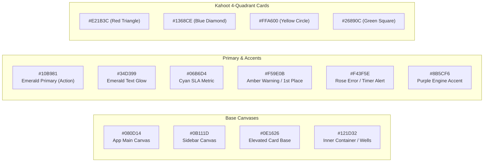

# UI/UX Architecture & Design System Tokens
## Visual Specification Inspired by Nutri-Track Modern Dark Health-OS Layout

---

### 1. Brand Identity & Visual Language
The platform utilizes an original, distraction-free **Dark Modern Tech Aesthetic** featuring deep space navy backgrounds, crisp border framing, glowing emerald primary action triggers, and high-contrast typography. It deliberately rejects noisy, cluttered cartoon motifs in favor of a clean, hyper-responsive experience suitable for universities, corporate training rooms, and competitive exam halls alike.

---

### 2. Design Tokens & Color Palette

#### 2.1 CSS Variables / Tailwind Token Definitions
- **`--bg-app`**: `#080D14` (Deep navy void)
- **`--bg-sidebar`**: `#0B111D` (Crisp docked sidebar background)
- **`--bg-card`**: `#0E1626` (Floating container card with 1px border `#1B2A44`)
- **`--bg-inner`**: `#121D32` (Inner metric card well with 1px border `#1F304E`)
- **`--border-card`**: `#1B2A44` (Subtle boundary separator)
- **`--emerald-main`**: `#10B981` (Primary interaction and confirmation pill)
- **`--text-primary`**: `#FFFFFF` (High contrast headers)
- **`--text-secondary`**: `#94A3B8` (Subtitles, units, and timestamps)
- **`--text-muted`**: `#64748B` (Labels, category tags, inactive borders)

---

### 3. Component Standards & Interaction States

#### 3.1 Buttons & Controls
- **Primary Pill (`btn-emerald-primary`):**
  - Background: `#10B981`, Text: `#042F2E` (Deep forest font for maximum contrast).
  - Shape: Rounded 12px pill with `gap-2` icon alignment.
  - Hover: Background shifts to `#34D399` with `translate-y(-1px)` and glowing box shadow `0 6px 18px rgba(16, 185, 129, 0.35)`.
- **Secondary / Ghost Action:**
  - Background: `#121D32`, Border: `1px solid #1F304E`, Text: `#94A3B8`.
  - Hover: Text becomes `#FFFFFF`, border shifts to `#34D399/40`.

#### 3.2 4-Color Kahoot Option Cards (Multiplayer Live Interface)
- Responsive 2x2 grid or stacked 4-row layout on mobile.
- Each button features a distinct shape badge in a translucent container:
  - **Option A (▲):** Red `#E21B3C` with 6px 3D depth shadow `#980D24`.
  - **Option B (◆):** Blue `#1368CE` with 6px 3D depth shadow `#093C78`.
  - **Option C (●):** Yellow `#FFA600` with 6px 3D depth shadow `#AB7000`.
  - **Option D (■):** Green `#26890C` with 6px 3D depth shadow `#144E05`.
- **Keyboard Shortcuts:** Built-in listener for numeric keys `1`, `2`, `3`, `4` or alphabetic `A`, `B`, `C`, `D` with visual active-state feedback.

#### 3.3 Dashboard Metric Cards (Nutri-Track Inspiration)
- 4-card horizontal flex/grid row (`SEARCH SLA`, `CACHE READ`, `QUIZZES`, `INDEX MODE`).
- Each card contains:
  1. Upper badge row with uppercase label and active SLA limit target.
  2. Hero metric value in large JetBrains Mono font (`24px font-extrabold`).
  3. Mini horizontal progress indicator showing percentage of specification utilized.

---

### 4. Page Hierarchy & User Journeys

#### 4.1 Host / Teacher Views
1. **Teacher Studio Dashboard:**
   - Left fixed sidebar navigation (Administration, Core Navigation, Quality Auditing status, user account switcher).
   - Main workspace with hero greeting, live SLA indicators, category pills, and responsive quiz catalog cards.
2. **Quiz Authoring Studio:**
   - Split-pane editor: Question prompt & KaTeX math preview on left; 4-option creator and distractor explanation editor on right.
   - Poka-Yoke indicator: Real-time checklist (Title valid ✓, 2+ options ✓, Answer key set ✓) enabling the "Publish" button only upon zero-defect verification.
3. **Live Game Host Console:**
   - Fullscreen mode with oversized room PIN (`591 024`) and QR code in lobby.
   - Live question counter, answer distribution bar charts updating in real time, and next-question controls.
4. **Cohort Reports & Gradebook:**
   - Paginated historical attempts table with search filtering, latency indicators, and CSV export.

#### 4.2 Participant / Student Views
1. **PIN Join Screen:**
   - Minimalist entry screen with 6-digit numeric input and nickname selector.
2. **Live Arena HUD:**
   - Synchronized question countdown bar, question counter (`Question 3 / 10`), real-time streak indicator (`🔥 3x Combo`), and current score points.
3. **Olympic 3D Podium & Question Review:**
   - 1st (Gold), 2nd (Silver), and 3rd (Bronze) animated podium step with user ranking, confetti burst, and collapsible accordion reviewing each answer.
4. **Mistake Notebook:**
   - Filterable catalog of previously failed questions with targeted "Smart Practice" test generation.
