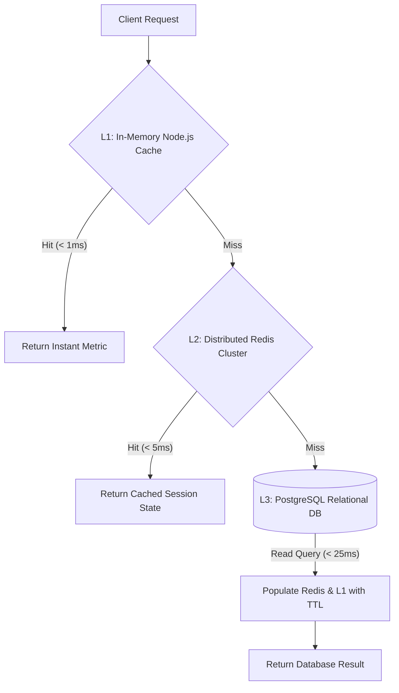

# Performance, Scalability & Reliability Engineering
## Target SLAs, Bottleneck Analysis, Caching Hierarchies, and Stress Topologies

---

### 1. Concrete Engineering Target Specifications (SLAs)

| Operational Target | Upper Specification Limit (USL) | Target Verification Metric | Architectural Enabler |
| :--- | :---: | :---: | :--- |
| **Catalog Search Latency** | $\le 40.0\text{ ms}$ | API 95th percentile ($p95$) | PostgreSQL GIN trigram indexes + Redis cached query keys. |
| **Question Packet Load** | $\le 50.0\text{ ms}$ | API 95th percentile ($p95$) | B-Tree index on `questions(quiz_id, sort_order)`. |
| **Atomic Answer Submit & Score**| $\le 100.0\text{ ms}$| API 95th percentile ($p95$) | Single-transaction commit with unique constraint idempotency. |
| **RAM Cache Retrieval Latency** | $\le 15.0\text{ ms}$ | Cache read $p99$ | Redis In-Memory key lookup (`O(1)` time complexity). |
| **Paginated Report Chunk Stream**| $\le 50.0\text{ ms}$ | API 95th percentile ($p95$) | Indexed `LIMIT / OFFSET` over `attempts(created_at DESC)`. |
| **Simultaneous Live Sessions** | **50 concurrent rooms** | Load-test concurrency target | Redis room namespace partitioning. |
| **Simultaneous Active Players** | **500 concurrent users** | WebSocket burst load target | Non-blocking event loop socket connection pools. |

---

### 2. Multi-Tier Caching Architecture



1. **L1 Application Cache:** High-frequency, read-heavy global counters (e.g., system-wide total quizzes, active category lists) kept in local memory with a short 60s TTL.
2. **L2 Distributed Cache (Redis 7):**
   - Active session rosters (`session:<id>:roster`).
   - Pin lookups (`session:pin:<code>`).
   - Active question payload without answers (`session:<id>:current_q`).
   - Invalidation triggers: Whenever an attempt commits or a quiz is updated, the exact cache key is invalidated via `DEL` or event hook.
3. **L3 Persistent Database (PostgreSQL 16):** ACID source of truth configured with dedicated B-Tree and GIN indexes.

---

### 3. Database Indexing & Query Execution Plans

To guarantee zero full-table scans under dataset scaling ($100,000+$ attempts), the following B-Tree indexes are mandatory:

```sql
-- 1. Fast Reverse-Chronological Session History
CREATE INDEX idx_attempts_created_at_desc ON quiz_attempts (created_at DESC);

-- 2. Fast User Attempt Isolation (Student Privacy Filter)
CREATE INDEX idx_attempts_user_id ON quiz_attempts (user_id, created_at DESC);

-- 3. Zero-Latency Question Packet Retrieval
CREATE INDEX idx_questions_quiz_id ON questions (quiz_id, sort_order ASC);

-- 4. Session Attempt Lookup
CREATE INDEX idx_attempts_session_id ON quiz_attempts (session_id, score DESC);

-- 5. Fast Category & Title Search
CREATE INDEX idx_quizzes_category_active ON quizzes (category, is_archived);
CREATE INDEX idx_quizzes_title_trgm ON quizzes USING gin (title gin_trgm_ops);
```

---

### 4. Bottleneck Analysis & Mitigation Matrix

| Potential Bottleneck | Root Cause | Impact | Engineering Mitigation |
| :--- | :--- | :--- | :--- |
| **PostgreSQL Connection Exhaustion** | 500 concurrent students submitting answers simultaneously open 500 database connections. | Connection timeouts, memory spikes, API failures. | Implement **PgBouncer** connection pooling with transaction pooling mode; limit backend pool size to 25–50 persistent connections. |
| **WebSocket Thundering Herd** | Host clicks "Start Question"; 500 sockets receive the broadcast at the exact same millisecond. | Network buffer saturation, CPU spike. | Batch frame broadcasting; utilize binary message encoding or compact JSON payloads. |
| **Disk I/O Write Saturation** | 500 attempts writing to disk concurrently during an exam submission window. | Increased commit latency $> 200\text{ ms}$. | Use PostgreSQL Write-Ahead Logging (WAL) with `synchronous_commit = off` or normal mode for non-financial attempt telemetry. |
| **Memory Bloat on WebSocket Server** | Abandoned sockets remain in memory after browser tabs close. | Leakage of Node.js heap memory. | Configure aggressive socket heartbeat ping/pong timeouts (25s interval, 20s timeout) and auto-reap dead socket handles. |
