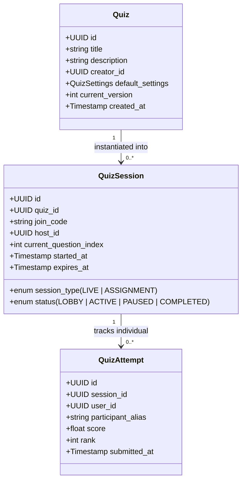

# Product Requirements Document (PRD)
## Next-Generation Quiz & Assessment SaaS Platform

---

### 1. Document Control & Metadata
- **Product Name:** Quiz System (Working Title / SaaS Project)
- **Document Version:** 1.0.0 (Phase 0 Planning Milestone)
- **Status:** Approved for Architectural Design (Pending Phase 1 Implementation Sign-Off)
- **Primary Stakeholders:** Educational Institutions, Corporate Organizations, Individual Learners, Trivia Creators

---

### 2. Executive Summary & Vision Statement
The **Quiz System** is a modular, high-concurrency assessment platform architected to eliminate the traditional divide between interactive gamified live games (e.g., Kahoot!, Blooket, Quizizz) and rigorous asynchronous examinations (e.g., Google Forms, Canvas Quizzes). 

The core thesis is **Content Unification**: Any single assessment authored within the platform must be instantaneously executable as either:
1. **A synchronous, low-latency multiplayer live session** driven by server-authoritative timers, participant pin-joining, item-level telemetry, and real-time leaderboards.
2. **An asynchronous self-paced assessment or assignment** featuring deadline scheduling, attempt limits, item randomization, and detailed post-submission pedagogical explanations.

---

### 3. Target Audiences & Personas

| Audience Segment | Primary Persona | Key Pain Points Addressed | Key Value Proposition |
| :--- | :--- | :--- | :--- |
| **K-12 & Higher Ed** | Teacher / Professor | Clunky interfaces, grading latency, separation of homework vs live review tools. | One quiz can be played live in class on Monday, then assigned as homework to absent students on Tuesday. |
| **Corporate Training** | HR & Compliance Officer | Low engagement in mandatory certifications, lack of verifiable audit trails. | Gamified live training sessions paired with verifiable self-paced compliance assessments with PDF certificate readiness. |
| **Independent Learners** | Competitive Exam Aspirants (GATE, UPSC, GRE) | Forgetting errors, lack of focused revision, superficial scoring. | **Mistake Notebook**: Automatically curates every incorrectly answered item into spaced-repetition practice sessions. |
| **Entertainment & Communities** | Trivia Host / Streamer | Complicated setups, participant lag, software installation requirements. | Zero-friction join via 6-character PIN or QR code; browser-native Web Audio and rich multimedia interaction. |

---

### 4. Reusable Content Model: The Fundamental Triad
A foundational architectural mandate is the strict decoupling of content from runtime state:

1. **Quiz (Content Entity):** The immutable/versioned bank of questions, options, metadata, and default scoring rubrics.
2. **Quiz Session (Runtime Orchestration Entity):** An ephemeral or scheduled instance of a Quiz (e.g., Live Game PIN `749201` on Friday morning, or Homework Assignment due next Friday).
3. **Quiz Attempt (Participant Entity):** A specific learner's execution stream within a Session, containing exact item responses, timestamps, server-computed points, and integrity markers.

---

### 5. Detailed Feature Specifications

#### 5.1 Authentication & User Management (Module 01)
- **Roles:** Superadmin, Creator/Host (Teacher/Trainer), Participant/Student (Registered), and Anonymous Guest (PIN Joiner).
- **Session Types:** Stateless JWT with HTTP-only, secure, SameSite cookies paired with refresh token rotation.
- **Organization Ready:** Multi-tenant database tenancy keys (`organization_id`) baked into tables from day zero.

#### 5.2 Quiz Studio & Authoring (Module 02 & 03)
- **Interactive Builder:** Block-based question authoring supporting Single Choice (MCQ), Multiple Choice (Multi-select), True/False, Fill-in-the-Blank, and Open Short Answer.
- **Poka-Yoke Input Mistake-Proofing:** Enforces strict validation prior to publishing:
  - At least two options for single/multi choice questions.
  - Exactly one designated correct option for MCQs; at least one for multi-select.
  - Positive time limits (5s to 300s per question) and positive mark allocations.
- **Rich Media Support:** Formatted text prompts, mathematical notation support (LaTeX KaTeX preview), and image prompt support.

#### 5.3 Question Bank (Module 04)
- **Tagging & Taxonomy:** Questions categorized by subject, topic, bloom's taxonomy level, and estimated difficulty.
- **Reusability:** Authors can pull previously created or shared questions from their personal or institutional repository into any new Quiz without duplicating data records.

#### 5.4 Live Multiplayer Engine (Module 05)
- **Zero-Friction Entry:** Participants join via 6-digit numeric PIN, direct URL, or QR Code without requiring an account (anonymous nickname with optional user account linking).
- **Server-Authoritative State:** The host controls state transitions (`LOBBY` $\rightarrow$ `COUNTDOWN` $\rightarrow$ `QUESTION_ACTIVE` $\rightarrow$ `ANSWER_REVEAL` $\rightarrow$ `LEADERBOARD` $\rightarrow$ `PODIUM`).
- **Real-Time Synchronization:** Questions broadcast simultaneously via WebSocket rooms. Timer synchronization enforced by server timestamps.
- **Anti-Cheat Item Concealment:** The WebSocket payload for `QUESTION_ACTIVE` **never** contains `correct_option` or grading metadata. Answers are only revealed when the server dispatches `QUESTION_RESULT`.

#### 5.5 Self-Paced Assessment Engine & Assignments (Module 06 & 07)
- **Deadline Scheduling:** Start window, strict submission deadline, and maximum duration stopwatch.
- **Randomization:** Optional question order shuffling and option order shuffling per attempt to minimize collusion.
- **Attempt Limits:** Configurable max attempts (e.g., 1 attempt for high-stakes exams, unlimited for practice).

#### 5.6 Server-Side Scoring & Gamification (Module 08 & 09)
- **Atomic Scoring Function:**
  $$\text{Score} = \text{Base Points} + \left( \text{Speed Bonus} \times \text{Streak Multiplier} \right)$$
  - *Base Points:* Fixed marks allocated to the question (e.g., 500 pts).
  - *Speed Bonus:* Scaled dynamically based on submission latency received before the question deadline.
  - *Streak Multiplier:* Consecutive correct answer streaks trigger multiplier increments ($1.0\times \rightarrow 1.2\times \rightarrow 1.5\times$).
- **Leaderboards & Podiums:** Real-time top 5/10 leaderboards computed in-memory and broadcast at item completion; final 3-tier Olympic podium at session termination.

#### 5.7 Mistake Notebook (Module 10)
- **Pedagogical Feedback Loop:** Any question answered incorrectly by an authenticated student is automatically logged into their personal `Mistake Notebook`.
- **Targeted Practice:** Students can launch personalized "Smart Practice" sessions filtered specifically from their historical failure modes.

#### 5.8 Analytics & Administration (Module 11 & 12)
- **Item-Level Discriminatory Analysis:** Breakdown of answer distributions per option (distractor analysis) to reveal ambiguous questions.
- **Cohort Performance:** Class average, median completion latency, pass/fail ratios, and exportable CSV/Excel reports.
- **Audit Trails:** Complete append-only logging of administrative actions, quiz edits, session launches, and permission changes.

---

### 6. Non-Functional Requirements (NFRs)
- **SLA - Search Latency:** $< 40\text{ ms}$ for catalog and tag queries.
- **SLA - Question Load Latency:** $< 50\text{ ms}$ for fetching session question packets.
- **SLA - Atomic Submission Latency:** $< 100\text{ ms}$ for scoring and persisting attempt answers.
- **SLA - Real-Time Broadcast:** Live question synchronization across connected sockets $< 500\text{ ms}$.
- **Availability Target:** 99.9% uptime during operational testing.
- **Data Integrity:** Zero data loss on submitted attempts; idempotent database writes to prevent duplicate scoring.
