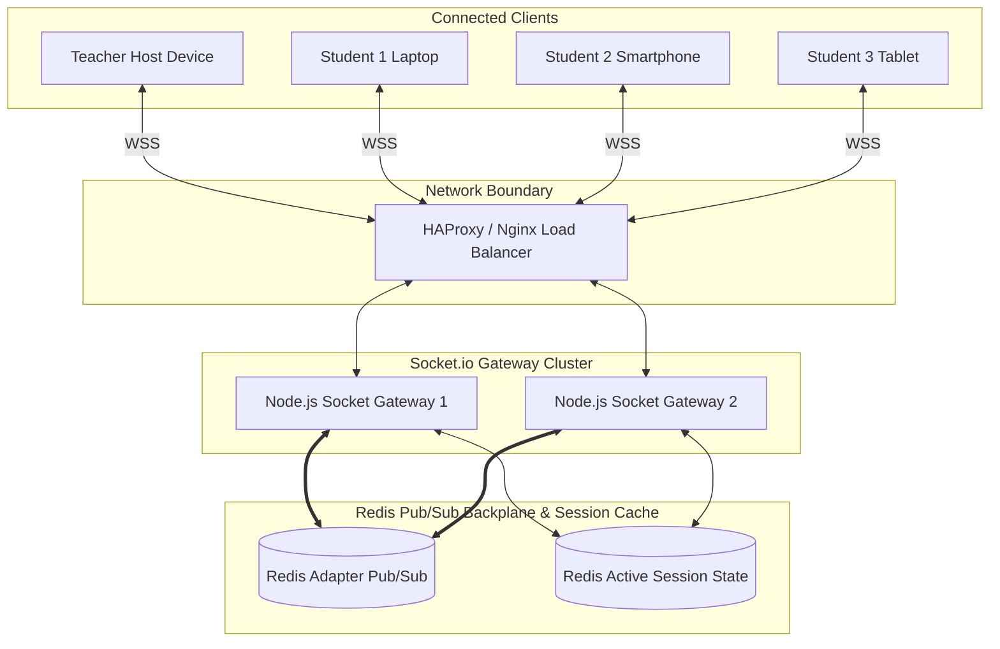

# Real-Time WebSocket Architecture & Event Contracts
## Low-Latency Synchronization, Anti-Cheat Masking, and Redis Pub/Sub Scaling

---

### 1. Architectural Principles of Real-Time Engine

1. **Server as Single Source of Truth:**
   Clients **never** dictate timers, correct answers, or awarded points. The server computes all countdown durations using high-precision timestamps (`process.hrtime.bigint()`).
2. **Zero-Knowledge Question Distribution (Anti-Cheat Masking):**
   When `question_active` is broadcast to student sockets, grading keys, marks flags, and explanations are scrubbed from the payload. Answer keys are only sent down the wire when the question's allotted time window has formally elapsed.
3. **Horizontal Socket Scalability (Redis Pub/Sub Adapter):**
   Multiple Node.js WebSocket gateway pods can run concurrently behind a load balancer. When a host clicks "Next Question" on Pod 1, the event is published to Redis channel `session:<id>`, which broadcasts to all participants connected across Pods 1, 2, and 3.



---

### 2. PIN Generation & Collision Prevention
- **PIN Format:** 6-character uppercase alphanumeric or numeric code (e.g., `591024`).
- **Namespace:** Valid only while session status is `LOBBY` or `ACTIVE`.
- **Generation Logic:** Cryptographically secure pseudorandom number generator (`crypto.randomInt`).
- **Atomic Registration:**
  ```sql
  -- Stored in Redis with atomic SETNX:
  SET session:pin:591024 <session_uuid> NX EX 14400
  ```
  If `SETNX` returns `0` (collision with an active room), the generator immediately tries another PIN, guaranteeing zero cross-session collision.

---

### 3. Comprehensive WebSocket Event Contract

All socket frames follow a standard envelope:
```json
{
  "event": "event_name",
  "sessionId": "uuid-v4",
  "timestamp": 1793339123456,
  "payload": { ... }
}
```

#### 3.1 Client $\rightarrow$ Server Events

| Event Name | Sender | Payload Schema | Validation & Security Checks |
| :--- | :--- | :--- | :--- |
| `join_session` | Participant | `{ joinCode: string, alias: string, userId?: string }` | Validates active PIN in Redis; sanitizes alias against profanity/XSS; assigns socket to room `session:<id>`. |
| `start_session` | Host | `{ sessionId: string }` | Verifies socket token corresponds to the session's designated `host_id`; transitions session state from `LOBBY` to `ACTIVE`. |
| `next_question` | Host | `{ sessionId: string }` | Verifies host credentials; increments question index; triggers server countdown timer. |
| `submit_answer` | Participant | `{ sessionId: string, questionId: string, optionKey: string, clientTimestamp: number }` | Rejects if question timer already closed; verifies question belongs to session; deduplicates submission per socket. |
| `end_session` | Host | `{ sessionId: string }` | Verifies host identity; commits all scores to PostgreSQL; emits final podium celebration event. |

#### 3.2 Server $\rightarrow$ Client Events

| Event Name | Receiver | Payload Schema | Purpose & Visual Action |
| :--- | :--- | :--- | :--- |
| `session_state_change` | All | `{ status: "LOBBY" \| "ACTIVE" \| "COMPLETED", activePlayersCount: number }` | Synchronizes room lobby status and participant counters. |
| `player_roster_update` | Host | `{ players: [{ alias: string, socketId: string, avatar: string }] }` | Updates host screen with joining student avatars in real time. |
| `question_active` | All | `{ questionIndex: number, totalQuestions: number, questionText: string, options: [{ key: 'A', text: '...' }], timeLimitSec: 20, serverStartTime: number }` | Initiates client timer bar and renders the 4 Kahoot/Quizizz colored option cards. **No answer keys included!** |
| `answer_acknowledged` | Participant | `{ status: "ACCEPTED", questionId: string }` | Confirms receipt of choice to participant UI, transitioning button into submitted state. |
| `question_result` | All | `{ correctOptionKey: "B", explanations: string, playerStats: { scored: 850, streak: 3, isCorrect: true }, classDistribution: { A: 2, B: 24, C: 1, D: 0 } }` | Dispatched after timer zero. Triggers correct/wrong sound effects, streak flame animations, and reveals distribution chart on host screen. |
| `leaderboard_update` | All | `{ topRanked: [{ rank: 1, alias: "Piyush", score: 2450, streak: 3 }, ...], userRank: 4 }` | Broadcasts top 5/10 leaderboard rankings after each question round. |
| `podium_celebration` | All | `{ first: { ... }, second: { ... }, third: { ... }, totalParticipants: 35 }` | Fires final Olympic 3D podium view with client confetti blast and victory fanfare. |

---

### 4. Disconnection & Reconnection Recovery
1. When a participant loses connection (network flap, browser reload):
   - Server does **not** discard their accumulated attempt score.
   - Socket is marked `DISCONNECTED` with a 90-second grace TTL in Redis.
2. Participant re-opens URL with previous session token:
   - Client sends `reconnect_session` with their `attemptId` or JWT.
   - Server re-attaches the new `socket.id` to the existing participant attempt and broadcasts the currently active question state with remaining timer seconds.
   - Prevents student frustration and guarantees zero data loss during unstable Wi-Fi connections.
