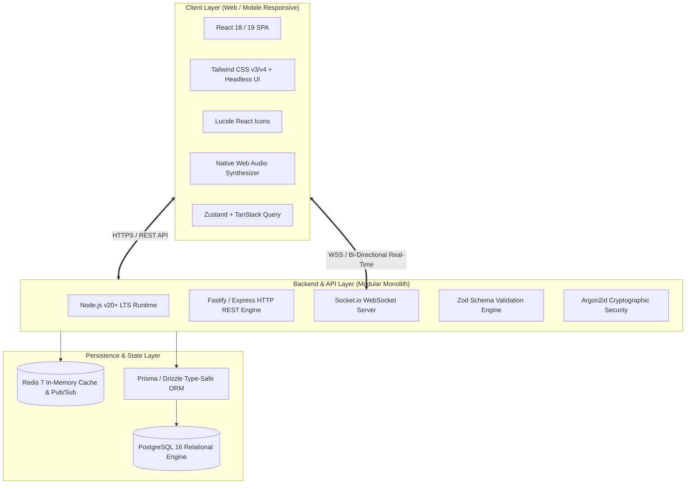

# Technology Stack Evaluation & Architectural Rationale
## Candidate Comparison, Trade-Off Analysis, and Selected Foundation

---

### 1. Architectural Strategy: The Modular Monolith
Prior to selecting libraries, we establish the system's macro-architecture. While cloud-native microservices are frequently touted for hyper-scale platforms, adopting microservices for an MVP introduces distributed state issues, network latency jitter across microservices, complicated distributed transactions, and severe operational overhead.

For this platform, we mandate a **High-Performance Modular Monolith**:
- Single unified codebase with strict boundary interfaces between modules (`auth`, `quiz`, `session`, `scoring`, `realtime`, `analytics`).
- Independent scalability of real-time WebSocket traffic using Redis Pub/Sub backplanes when horizontal scaling is required.
- Single database transaction domain guaranteeing zero-loss atomic submissions.

---

### 2. Technology Stack Evaluation Matrix

We evaluate two production-grade, enterprise-ready candidate technology stacks:

- **Stack Alpha (TypeScript Full-Stack Monorepo):** Next.js 14 / React + Node.js (Fastify/Express) + Socket.io + PostgreSQL (Prisma/Drizzle) + Redis.
- **Stack Beta (Polyglot High-Performance Stack):** React (Vite) + Go / Python (FastAPI) + WebSockets + PostgreSQL (SQLAlchemy/GORM) + Redis.

| Criteria | Weight | Stack Alpha (Node/TS + React + PG + Redis) | Stack Beta (Go/Python + React + PG + Redis) | Architectural Evaluation & Rationale |
| :--- | :---: | :---: | :---: | :--- |
| **Development Speed** | 15% | **9.5 / 10** | 7.5 / 10 | Shared TypeScript types between frontend and backend contracts prevents interface mismatches and eliminates schema re-definitions. |
| **Real-Time Performance** | 15% | **9.0 / 10** | 9.5 / 10 | Go has superior raw goroutine concurrency, but Node.js non-blocking event loop handles 10,000+ persistent idle WebSockets effortlessly with Socket.io/uWebSockets. |
| **Maintainability** | 15% | **9.0 / 10** | 8.0 / 10 | Unified language context reduces context switching. Refactoring across domain boundaries is compiler-verified end-to-end. |
| **Database & Relational Model** | 15% | **9.5 / 10** | 9.0 / 10 | PostgreSQL is the gold standard for both stacks. Type-safe ORMs (Prisma / Drizzle) provide instant schema validation. |
| **Security & Ecosystem** | 10% | **9.0 / 10** | 9.0 / 10 | Battle-tested authentication libraries (`argon2`, `jsonwebtoken`, `helmet`, `cors`, `zod`). |
| **Hosting & Infra Cost** | 10% | **9.0 / 10** | 8.5 / 10 | Can run completely on low-cost containers (Docker, Render, Railway, or VPS) with minimal footprint ($10–$25/mo). |
| **Developer Productivity** | 15% | **9.5 / 10** | 7.5 / 10 | Single language, single package manager (`npm`/`pnpm`), identical testing frameworks (Vitest/Jest). |
| **Total Weighted Score** | 100% | **9.25 / 10 (WINNER)** | **8.25 / 10** | **Stack Alpha is the strongly recommended stack.** |

---

### 3. Final Selected Technology Stack

---

### 4. Deep-Dive Technology Justifications & Trade-Offs

#### 4.1 Frontend Architecture
- **Framework:** **React (via Vite)**
  - *What it does:* Powers the interactive SPA client, responsive Quiz Studio, live player interface, and analytics dashboards.
  - *Why selected:* Fast HMR, massive ecosystem, rich component libraries, lightweight bundle sizes compared to full Next.js SSR when building high-concurrency client-side live game clients.
  - *Alternatives considered:* Next.js (SSR adds server overhead for live socket game rooms), Vue.js (smaller team ecosystem).
  - *Trade-offs:* Client-side rendering requires initial asset download, mitigated through Vite's chunk splitting and gzip/brotli compression.
- **Styling:** **Tailwind CSS + Custom Design System Tokens**
  - *What it does:* Provides utility-first, deterministic CSS compilation without runtime stylesheet overhead.
  - *Why selected:* Prevents style bleeding, enables rapid dark/light theme switching, produces tiny production CSS bundles (<35 KB).
- **Client State & Server Cache:** **Zustand + TanStack Query (React Query)**
  - *What it does:* Zustand manages local live quiz game state (countdown timers, selected cards, audio preferences). TanStack Query manages asynchronous server state (caching, background revalidation, optimistic updates).

#### 4.2 Backend & API Architecture
- **Runtime & Language:** **Node.js LTS (v20+) with TypeScript**
  - *What it does:* Serves REST endpoints, coordinates business logic, enforces Poka-Yoke validation rules, and handles asynchronous database I/O.
  - *Why selected:* Non-blocking event-driven I/O model is uniquely suited for chatty, concurrent WebSocket connections. Shared schemas with client via Zod.
  - *Alternatives considered:* Python FastAPI (slower on high-frequency WebSocket broadcasting), Go (slower development iteration for complex CRUD).
- **Validation Engine:** **Zod**
  - *What it does:* Enforces strict contract boundaries for all incoming HTTP requests and WebSocket payload frames.
  - *Why selected:* Type inference directly creates TypeScript types from validation schemas, preventing drift between docs and runtime code.

#### 4.3 Database & In-Memory Layer
- **Primary Database:** **PostgreSQL 16**
  - *What it does:* Stores normalized, ACID-compliant relational data (Users, Quizzes, Questions, Attempts, Audit Logs).
  - *Why selected:* Superior JSONB indexing support, row-level locking for transactions, robust constraints, proven reliability under high transaction volumes.
  - *Trade-offs:* Requires careful connection pooling (PgBouncer) under thousands of concurrent connections.
- **In-Memory Cache & Pub/Sub:** **Redis 7**
  - *What it does:*
    1. Caches hot aggregate metrics and catalog queries to guarantee $< 15\text{ ms}$ response times.
    2. Stores ephemeral session states (lobby participant rosters, socket ID mappings).
    3. Serves as Redis Pub/Sub adapter to allow horizontal scaling of WebSocket nodes.
  - *Trade-offs:* State must be backed up or cleanly recoverable from PostgreSQL upon Redis restart.
