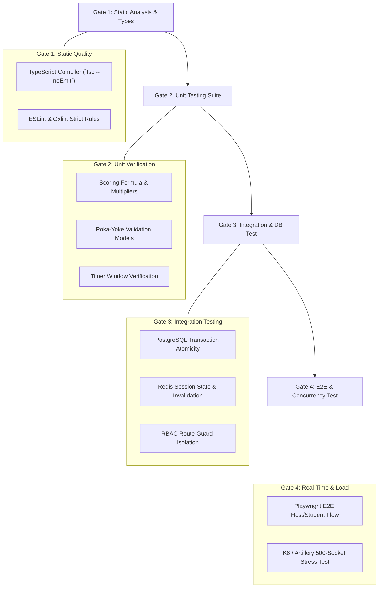

# Quality Assurance, Verification & Testing Strategy
## Unit, Integration, End-to-End, Security, and Concurrency Audits

---

### 1. Verification Hierarchy & Quality Gates

Every code change must pass four rigorous testing gates prior to production deployment:

---

### 2. Test Suite Specifications

#### 2.1 Unit Tests (Vitest / Jest)
- **Scoring Engine:**
  - Verify base score calculation for correct options.
  - Verify zero score and streak reset for wrong choices.
  - Verify speed bonus curve calculations under varying latency inputs.
  - Verify streak multiplier thresholds ($1\times \rightarrow 1.2\times \rightarrow 1.5\times$).
- **Poka-Yoke Input Validators:**
  - Verify rejection of quizzes with empty titles or blank categories.
  - Verify rejection of questions without an assigned correct option.
  - Verify rejection of negative or zero time limits and durations.

#### 2.2 Integration Tests (Supertest + Testcontainers / Ephemeral PostgreSQL)
- **Authentication & RBAC:**
  - Test registration, password hashing verification, and token rotation.
  - Verify that a `STUDENT` token receives `403 Forbidden` when attempting to call `POST /api/v1/quizzes` or view other students' attempts.
- **Database Atomicity & Idempotency:**
  - Execute concurrent duplicate answer submissions with identical attempt/question IDs; verify that exactly one record commits and duplicate calls return `409 Conflict` or idempotent success without score inflation.
- **Cache Lifecycle:**
  - Call `GET /metrics/dashboard` $\rightarrow$ verify DB query executed.
  - Immediately call again $\rightarrow$ verify cache hit latency $< 1\text{ ms}$ and zero DB queries executed.
  - Submit an attempt $\rightarrow$ verify cache key is automatically invalidated.

#### 2.3 End-to-End (E2E) Browser Testing (Playwright)
- **Host & Player Dual-Browser Journey:**
  1. Browser 1 (Host): Log in $\rightarrow$ Launch Live Session $\rightarrow$ display Room PIN `482910`.
  2. Browser 2 (Student): Navigate to `/join` $\rightarrow$ input PIN `482910` and nickname `Piyush` $\rightarrow$ verify nickname appears on Host screen.
  3. Host clicks "Start" $\rightarrow$ verify Student screen renders 4 Kahoot colored option cards without answer keys.
  4. Student clicks Option B $\rightarrow$ verify answer received $\rightarrow$ timer expires $\rightarrow$ verify podium results rendered.

#### 2.4 Real-Time Concurrency & Load Testing (Artillery / K6)
- **Test Objective:** Validate 500 concurrent WebSocket connections across 50 simultaneous live rooms.
- **Pass Criteria:**
  - Socket connect latency $p99 < 500\text{ ms}$.
  - Question broadcast latency across all connected sockets $< 1000\text{ ms}$.
  - Zero dropped connections or server memory leaks during a 15-minute simulated test.
